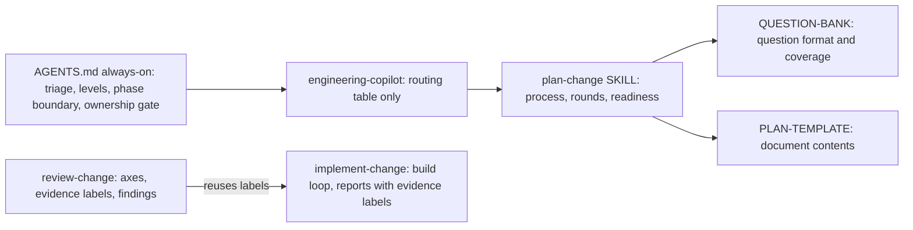

# Skill compression, request triage, and skill lint

Level 2 (it changes agent behavior across every skill). Baseline: working tree on 2026-11-13; word counts measured with `rg -o "\S+" --count-matches`.

## Decisions (user-confirmed 2026-11-13)

- **D-01 (Q-01): Level 1 gets an inline plan, not a saved one.** The sequence is brief explore, then a 5-10 line chat plan (behavioral home, files and symbols, steps, checks, assumptions), then implement, verify, review if useful, and a short handoff. A saved `plan-change` plan is written only when you ask for one or the change grows to Level 2. This removes today's contradiction between [AGENTS.md](../../AGENTS.md)/[README.md](../../README.md) (no plan) and [ship-change](../../.agents/skills/ship-change/SKILL.md)/[engineering-copilot](../../.agents/skills/engineering-copilot/SKILL.md) (saved plan plus acceptance).
- **D-02 (Q-02): First-turn triage goes in AGENTS.md as a ~100-word section.** Its cost is paid for by trimming duplication in AGENTS.md, so the file still shrinks overall.
- **D-03 (Q-03): The curriculum in frontend-manual-practice moves** to a new `frontend-manual-practice/CURRICULUM.md`.
- **D-04 (my recommendation; accepting this plan confirms it): dedupe the hint ladder inline instead of creating a shared file.** The installer copies only the skill directories it names ([bin/install.mjs](../../bin/install.mjs) `CORE_SKILLS`/`EXTRA_SKILLS`), so a `_shared/` folder would never be installed. The ladder is also only about 60 words, so a separate file read would cost more than it saves.

## Audit review (review-change, static only)

The audit's numbers hold up (for example, `engineering-copilot` is 2,547 words and `review-change` is 2,611). Here is how each of its proposals is handled:

- **Accepted as written:** A2, A7, A8, B5, B7, C6, E2, E4.
- **A1 (dedupe the documentation-only rule), modified:** keep a ~60-word version inside `plan-change` and `review-change`, and remove it from `PLAN-TEMPLATE.md`, `QUESTION-BANK.md`, `ship-change` and `README.md`. The reason is that `writeClaudeMd` in [bin/install.mjs](../../bin/install.mjs) generates a Claude `CLAUDE.md` that leaves the rule out, so Claude-based planning and review can't depend on AGENTS.md alone.
- **A3 (frontend-manual-practice curriculum):** handled by D-03.
- **A4 (review-change), modified:** fold the 5-step "suspected violation trace" into the finding format, which already has evidence, counterexample, fix and verification fields. No companion file.
- **A5 (shared hint ladder), modified:** the audit is wrong about `tutor-me`, which has no hint ladder. The real duplication is inside `guided-implementation`, which defines both "Progressive Disclosure" and "Hint Ladder" (see D-04).
- **A6 (shorter descriptions), strengthened:** the host index cuts descriptions off at about 200 characters, which removes the "Use when" trigger for `engineering-copilot`, `plan-change`, `review-change` and `implement-change`. Rule: put the trigger first and keep descriptions at 200 characters or fewer, with no "Best with ..." text.
- **B1 (move architecture guidance to a new skill), modified:** no new skill. Add one line to `plan-change` and `implement-change` saying existing repository conventions take precedence.
- **B2 (terse-communication risk), minor:** the "full sentences when precision matters" rule already exists. Add one short before/after example only.
- **B3 (evidence ledger), partly already present:** output-contract item 4 already asks for the evidence labels. Add "UNKNOWN is not terminal for a critical invariant" and make the ledger required at L2–L3.
- **B6 (tutor-me invocation flag), resolved:** Cursor honors `disable-model-invocation` (`tutor-me` doesn't appear in the model-visible skill index). Keep it.
- **C1–C5 (first-turn questioning):** become the AGENTS.md triage section (D-02), with the good/bad question example lifted into it.
- **Rejected:** E1 `_shared/` (it wouldn't be installed), E3 `_INDEX.md` (hosts already index skill descriptions), and a new `code-architecture` skill.

**New findings the audit missed:**

- **N-1:** the [frontend-interview-drill](../../.agents/skills/frontend-interview-drill/SKILL.md) description contains an unquoted `: `, which is invalid YAML. Its description doesn't load, so the skill can't be routed to.
- **N-2:** the Level 1 contradiction described in D-01.
- **N-3:** `plan-change` SKILL §2 repeats the QUESTION-BANK question format, and §6 repeats PLAN-TEMPLATE §5/§7/§8.
- **N-4:** AGENTS.md "Understanding requirement" is a subset of "Ownership gate".
- **N-5:** `architecture-picture` uses G0–G3 labels where every other file uses L0–L3.

**Out of scope, flagged only:**

- `c:\Projects\AGENTS.md` is a stale copy that loads alongside the repo's AGENTS.md, costing about 1,000 duplicate words per turn in this workspace.
- `--repo` overwrites a product repo's existing `AGENTS.md`.

## Where the canonical rules will live



## Invariants for this change

- **I-1:** `plan-change` and `review-change` still state, in their own text, that they never execute code (because Claude's `CLAUDE.md` doesn't carry this rule).
- **I-2:** AGENTS.md line 1 stays `# AGENTS.md` and line 3 stays the pointer line, because `rewriteAgentsMd` replaces `lines[2]`.
- **I-3:** skill names and directories don't change, every relative `.md` link resolves, and every skill directory is listed in `CORE_SKILLS` or `EXTRA_SKILLS`.
- **I-4:** the Level 1 rule reads the same in AGENTS.md, README, ship-change, engineering-copilot, plan-change and implement-change.
- **I-5:** every SKILL.md frontmatter parses, and its description starts with `Use ` and is 200 characters or fewer.

## Ordered steps

**S-00 Records.** Save this plan as `docs/plans/2026-11-13-skill-compression.md`, and save the decisions plus the audit review as `docs/decisions/2026-11-13-skill-compression.md`. `docs/` isn't in `package.json` `files`, so it won't ship.

**S-01 Skills lint test (written first, expected to fail).** New file `test/skills.test.mjs`, using `node:test` with no dependencies. It checks:

- **Frontmatter:** each `.agents/skills/*/SKILL.md` starts with `---`, and `name:` equals the directory name.
- **Description:** the description, either a single line or a folded `>-` block, starts with `Use `, is 200 characters or fewer, and if it's an unquoted single line it contains neither `: ` nor ` #`.
- **Links:** every relative `](x.md)` link in any skill `.md` file resolves on disk.
- **Installer lists:** every skill directory name appears in the `CORE_SKILLS` or `EXTRA_SKILLS` text in `bin/install.mjs`.
- **Word caps:** each SKILL.md has at most 1,800 words, and AGENTS.md has at most 1,000.
- **Shared counter:** word counts use `text.split(/\s+/).filter(Boolean).length`, which matches the `rg` measure.

In `package.json`, change `test` to `node --test test/install.test.mjs test/skills.test.mjs`. Leave `shebang.test.mjs` out as it is today.

Expected result: N-1 and most descriptions fail. That's the baseline.

**S-02 AGENTS.md (always-on, target 950 words or fewer, currently 977).**

- Add a "Request triage" section after Hard rules (proposed text, not yet executed):

```markdown
## Request triage (first reply to non-trivial work)
1. State a level guess (L0-L3) and the one-line reason.
2. Check five slots: outcome (observable "done"), scope (in/out), behavior that must not change, constraints the change plausibly touches (security, data, compat, perf, cost), verification.
3. Slot inferable and change reversible: state the assumption in one line and proceed. Answer changes the design and cannot be safely assumed: ask.
4. Ask one batched round. Each question: concrete scenario, options with consequences, recommendation first; use the host's structured question tool when available. Never ask "any edge cases?"
5. L2-L3: route to `ship-change`; `plan-change` owns further questioning.
```

- Change the L1 row of the complexity table to: `brief explore → inline plan → implement → verify → review if useful → short handoff`.
- Delete "Understanding requirement" and add one line to Ownership gate saying the engineer must be able to explain every item in it.
- Compress "Agent roles" to two lines.
- Name the boundary paragraph in Verification "Phase boundary" so skills can cite it.

**S-03 Descriptions (fixes N-1 and A6).** Rewrite all 14 as `>-` blocks with the trigger first and 200 characters or fewer. Examples:

- **plan-change:** "Use before nontrivial (L2-L3 or requested) implementation. Interviews in rounds, then writes a decision-complete plan: file/symbol map, code samples, ordered steps, checks. Documentation only."
- **frontend-interview-drill:** "Use when the user wants interview-style TypeScript, React or Next.js challenges. Assigns test-first drills, hints without spoiling, runs tests to grade."

Keep `tutor-me`'s `disable-model-invocation`.

**S-04 engineering-copilot (2,547 words to about 700).** Keep, in this order:

- the purpose (3 lines) and the hierarchy diagram;
- the "What should I do?" format (SITUATION → RISKS → APPROACH → WHY → NEXT ACTION);
- a routing table with one row per situation A–Q (skill plus a one-line repo-specific note, such as "UI restrictions are not security", "characterization tests before legacy edits", "measure before optimizing", "debt: ACTIVE PAIN first");
- at most 7 stances: the collaboration unit is a meaningful conceptual change; don't narrate routine work; match pace to comprehension; just-in-time teaching as CONCEPT→WHY→HOW→HERE→FAILURE MODE; quiz instead of re-explaining; explain at the SYSTEM→FLOW→DECISION level; rigor scales with risk.

Delete the domain checklists K–O, which [QUESTION-BANK.md](../../.agents/skills/plan-change/QUESTION-BANK.md) §5–7 already cover. Also delete the reasoning framework, delegation, context, multi-agent and final-principle sections, which AGENTS.md and engineering-handoff already cover.

**S-05 plan-change bundle (4,549 words to about 3,600).**

- **[SKILL.md](../../.agents/skills/plan-change/SKILL.md):**
  - Shrink the boundary text to about 60 words. Keep its own no-execution rule and the BLOCKED rule, and cite AGENTS.md "Phase boundary".
  - Replace the §2 question-format paragraph with a pointer to QUESTION-BANK.
  - Add the D-01 Level 1 inline-plan rule, keeping the existing "an explicit request overrides" rule.
  - Add a **playback** step: after discovery and before round 1, restate the goal, scope, preserved behavior and KNOWN/ASSUMED/UNKNOWN in at most 5 lines, and ask you to confirm or correct it.
  - Add to §3: "existing repository conventions win; apply this where no pattern exists."
  - Cut §6 to 3 bullets plus "follow PLAN-TEMPLATE.md".
- **QUESTION-BANK.md:**
  - Make the boundary text one line.
  - Round discipline: order the frontier by downstream impact, ask at most 5 questions per round, add a short mental-model primer when a question needs context the engineer may lack, and give prose context in the message with short option labels in the structured tool.
  - Add a one-line bad-versus-good example.
  - §7: add an observability question ("what production signal shows it works or fails, and who watches it") and a cost/quota question ("expected call volume, unit cost, ceiling, behavior when hit").
- **PLAN-TEMPLATE.md:** make the boundary text one line.

**S-06 review-change (2,611 words to about 1,600).**

- Shrink §0 to about 70 words, keeping the bans, "inert documentation", and "a request to fix is a phase transition".
- Fold the §2A trace list into the §6 counterexample field.
- Compress the §2B smell list to one sentence.
- Add to §2C: "UNKNOWN is not terminal for a critical invariant: name the verification that resolves it or record the engineer's explicit risk acceptance."
- §4: one line per step.
- §7 item 4: ledger required at L2–L3.

**S-07 implement-change (1,533 words to about 1,300).**

- §0: "for L1 the agreed inline plan is the contract; for L2–L3 read the accepted plan from disk."
- §3: the existing-conventions line.
- §4: one before/after example (routine status stays terse, while an irreversible-action warning stays in full sentences), and trim duplicated bullets.
- §5: report evidence with review-change labels (TESTED, STATICALLY SUPPORTED, UNKNOWN).

**S-08 guided-implementation (1,105 words to about 700).** Merge Progressive Disclosure into the Hint Ladder. Merge "Optimized Guidance" and "Acceleration" into one list of techniques with one example each. Drop the TODO-laden template and the duplicate "Integration with Other Skills" diagram.

**S-09 frontend-manual-practice (1,956 words to 900 or fewer, D-03).** Move §4, §5, §8 (example apps), §9, §14 and §15 verbatim into the new `CURRICULUM.md`. Keep the behavioral sections 1–3, 6, 7, 10–13 and the completion rule, with a compact ladder. Add: "Read CURRICULUM.md when designing an exercise or rotation."

**S-10 Small skills.**

- **[diagnose-bug](../../.agents/skills/diagnose-bug/SKILL.md):** "After two consecutive experiments that eliminate no hypothesis, or when the next step would be a speculative production edit, stop and report the hypotheses, the evidence, and the experiment needed."
- **[ship-change](../../.agents/skills/ship-change/SKILL.md):** make the boundary text one line, replace the table with a link to AGENTS.md levels, and add the L1 inline path.
- **[architecture-picture](../../.agents/skills/architecture-picture/SKILL.md) and HTML-PAGE.md:** change G0–G3 to L0–L3, and remove the `codebase-design` and `improve-codebase-architecture` conditionals.

**S-11 README.** Replace the Roles boundary paragraph with a one-line pointer, update the L1 line, and mention triage.

## Verification (implementation phase, not run during planning)

- `npm test` in the repo root. Expected: the 4 install tests and all skills lint tests pass.
- `rg -n "G0|G1|G2|G3|codebase-design|improve-codebase-architecture" .agents` returns no matches.
- `rg -n "L1|Level 1" AGENTS.md README.md .agents/skills`: every hit is consistent with D-01 (I-4).
- `rg -o "\S+" --count-matches --hidden -g "*.md" .agents/skills AGENTS.md`: the word targets above are met. Expected total on-demand reduction is about 28%. The full L2 path goes from about 12.6k to about 9.2k words.
- Manual check: in a fresh Cursor chat, the skill index shows a description for `frontend-interview-drill`, and the trigger text is visible for `plan-change`.
- After acceptance, and only with your approval: run `node bin/install.mjs --user --compat` to refresh the installed user-level copies.